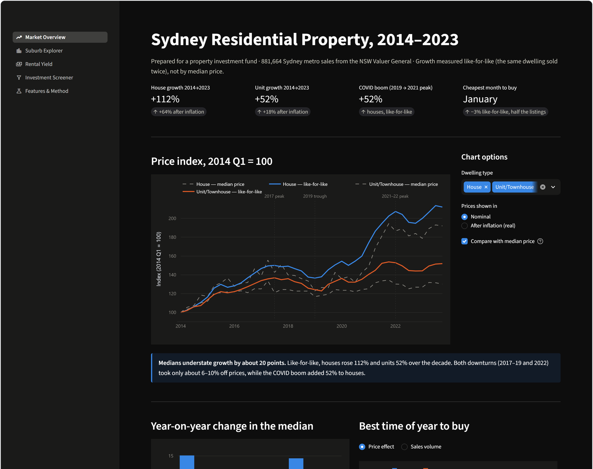
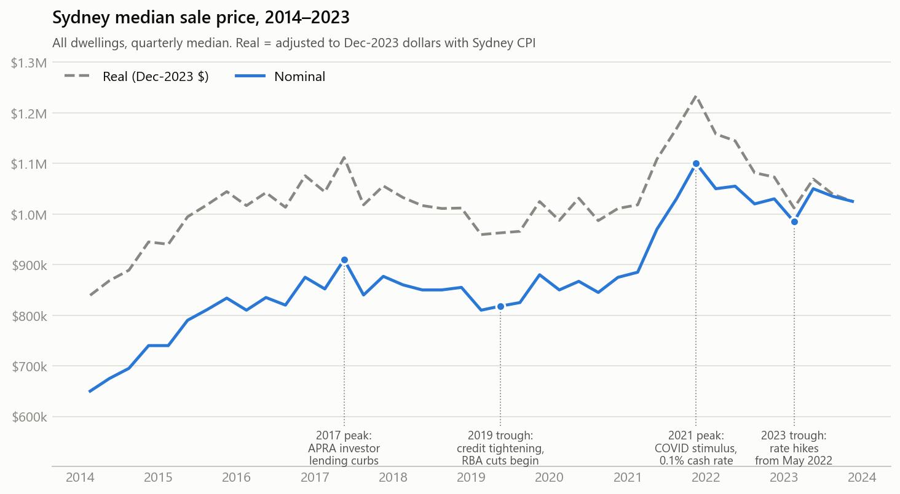
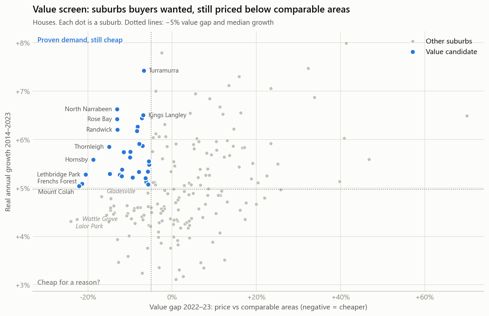
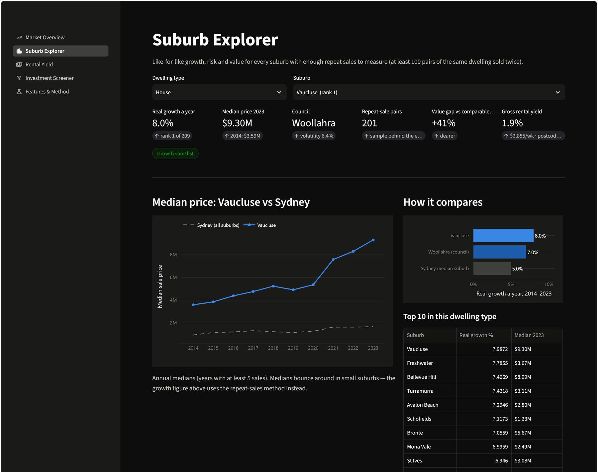
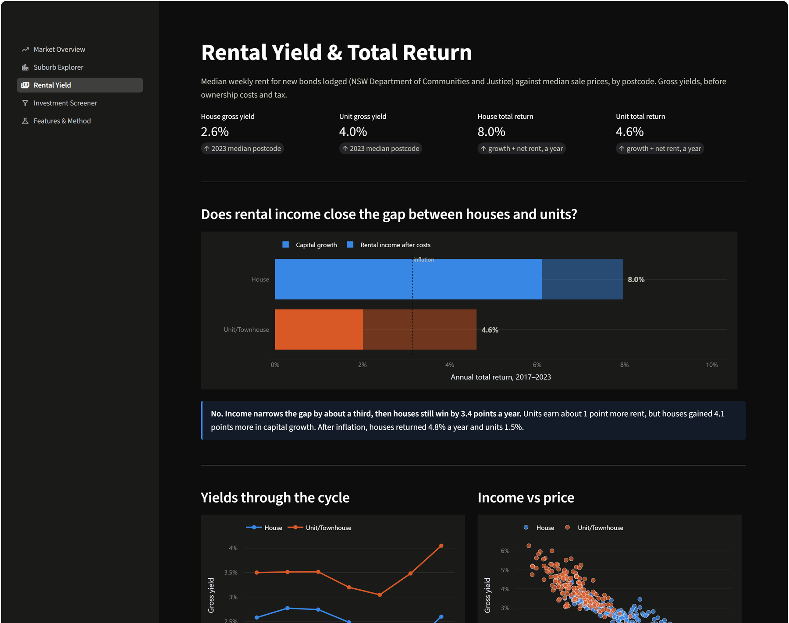
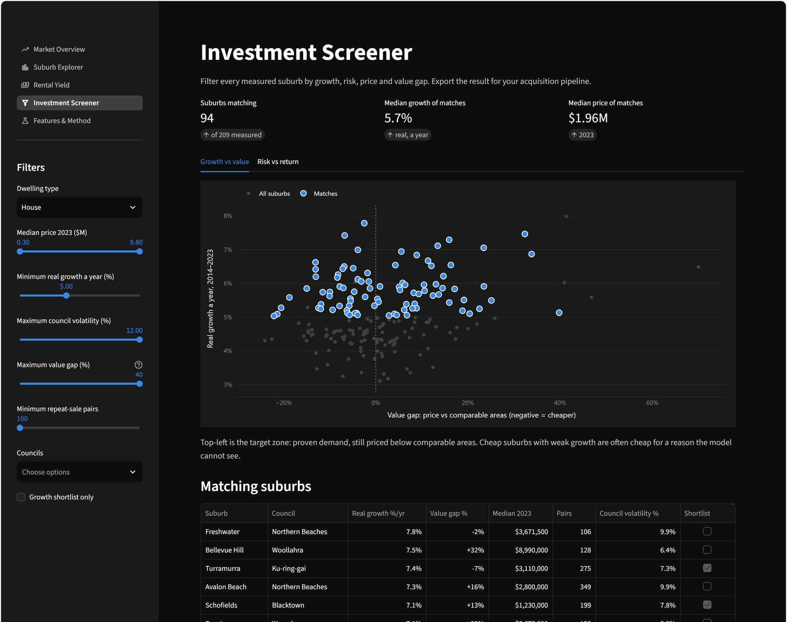

# Sydney Residential Property Analysis (2014–2023)

An end-to-end analytics project on the Sydney housing market, framed as a real engagement: a property
investment fund wants evidence on **where**, **what type** and **when** to buy.

**[→ Live dashboard](https://sydney-property-analysis.streamlit.app/)** · **[Executive summary](docs/executive_summary.md)** · **[Notebooks](notebooks/)** ·
**[Data quality report](docs/data_quality_report.md)** · **[Project brief](docs/project_brief.md)**

Built with Python (pandas, scikit-learn, statsmodels) on **881,664 NSW Valuer General sales**, with an interactive
Streamlit dashboard.

[](https://sydney-property-analysis.streamlit.app/)


---

## Headline findings

| | Finding |
|---|---|
| **Growth is understated by medians** | Like-for-like (the same dwelling sold twice), houses rose **112%** and units **52%** over the decade — about 20 points more than median prices suggest. After inflation: **+64%** and **+18%**. |
| **Houses beat units decisively** | **+37%** vs **−2%** real growth; a house now costs **1.9× a unit**, a decade high. |
| **Rent doesn't change that** | Total return (growth + net rent, 2017–23) was **8.0% a year for houses vs 4.6% for units**. Income narrows the gap by a third and no more. |
| **Income and growth trade off fairly — for houses** | House total return is 10.5–10.8% a year in *every* yield quartile. For units, the **highest-yield markets returned least**. |
| **Off-the-plan units underperform** | Units first sold off the plan resold **9.0% below** market value (±0.3%, 28,736 sales). Buy established stock instead. |
| **Prestige outgrew affordable** | The most expensive suburbs in 2014 grew *fastest* (r ≈ 0.5), against the common "affordable has more room" belief. |
| **Return without extra risk** | For houses, Woollahra, Willoughby, Ku-ring-gai and Mosman combined top growth with below-median volatility, and held their value in the 2017–19 downturn while the west fell 7–10%. |
| **Feature sweet spot** | Target 4–5 bedrooms, 3 bathrooms, 2 car spaces. A 6th bedroom (−1%) and 3rd car space (0%) add nothing. |
| **Timing** | Cycle timing matters ~10× more than seasonality. January is ~3% cheaper like-for-like, with half the listings. |
| **Income sweet spot** | A 4th bedroom adds ~5% to a house's price but ~28% to its rent. |



---

## What makes this more than a chart exercise

Four problems that a naive analysis would have gotten wrong, each caught and fixed:

**1. The median lies about growth.** Median prices track *what sold*. New, cheaper stock drags them down. Growth is
therefore measured with a **repeat-sales index** (the method behind CoreLogic and Case-Shiller): 111,870 pairs of the
same dwelling sold twice. [Notebook 02](notebooks/02_suburb_growth_risk.ipynb)

**2. New estates faked the top of the growth rankings.** On a new estate the first recorded "sale" is often the vacant
lot: a Marsden Park block sold for $385k in 2015 and $871k as a finished house in 2023. That's construction, not
market growth. Excluding new dwellings' first sales cut Marsden Park's measured growth from **19% to 6% a year**.

**3. Small suburbs won by luck.** A suburb with 100 sales can post an extreme growth rate by chance. Empirical-Bayes
shrinkage pulls each estimate toward the Sydney average in proportion to its uncertainty. Risk is measured at
**council** level, because suburb-level volatility turned out to be mostly sampling noise (a dozen suburbs measured
exactly zero).

**4. "Undervalued" suburbs were mostly cheap for a reason.** The value model's top picks were Kurnell (former
refinery, flight paths), Kings Park (industrial) and Carramar (flood-prone) — disamenities no model can see. The
screener therefore requires **independent evidence of demand** (above-median past growth) alongside the price gap.
[Notebook 03](notebooks/03_features_and_value.ipynb)



---

## The dashboard

Four pages built with Streamlit and Plotly:

| Page | What it answers |
|---|---|
| **Market Overview** | Price cycles, nominal vs real, like-for-like vs median, seasonality |
| **Suburb Explorer** | Growth, rank, risk, value gap and yield for any suburb, with price history |
| **Rental Yield** | Yields through the cycle, total return by segment, income vs price by postcode |
| **Investment Screener** | Filter by budget, growth, volatility and value gap; export the shortlist |
| **Features & Method** | What each bedroom/bathroom/car space is worth, plus method and limitations |

**Suburb Explorer** — every measured suburb, with growth, risk, value gap, yield and price history:



**Rental Yield** — does rental income close the gap between houses and units?



**Investment Screener** — filter on the fund's criteria and export the result:



Run it locally:

```bash
pip install -r requirements.txt     # dashboard only
streamlit run app/app.py
```

To rerun the analysis instead, install the full environment with
`pip install -r requirements-dev.txt`.

---

## Business questions

| # | Question | Where |
|---|---|---|
| Q1 | How have prices moved, and what drove the cycles? | [01](notebooks/01_market_overview.ipynb) |
| Q2 | Which suburbs grew fastest? | [02](notebooks/02_suburb_growth_risk.ipynb) |
| Q3 | Houses vs units: which kept pace with inflation? | [01](notebooks/01_market_overview.ipynb) |
| Q4 | What are bedrooms, bathrooms and parking worth? | [03](notebooks/03_features_and_value.ipynb) |
| Q5 | Is there a best time of year to buy? | [01](notebooks/01_market_overview.ipynb) |
| Q6 | Which suburbs look undervalued? | [03](notebooks/03_features_and_value.ipynb) |
| Q7 | Which areas gave return without extra risk? | [02](notebooks/02_suburb_growth_risk.ipynb) |
| Q8 | What do properties yield, and does income change the houses-vs-units answer? | [04](notebooks/04_rental_yield.ipynb) |

---

## Data

| Source | Provides | Rows used |
|---|---|---|
| [NSW Valuer General sales](https://www.kaggle.com/datasets/josephcheng123456/nsw-australia-property-data) (Kaggle) | Every Sydney metro residential sale, 2014–2023 | 881,664 after cleaning |
| [Domain Sydney listings](https://www.kaggle.com/datasets/alexlau203/sydney-house-prices) (Kaggle) | Bedrooms, bathrooms, parking, suburb fundamentals | 7,290 houses |
| [ABS Sydney CPI](https://www.abs.gov.au/statistics/economy/price-indexes-and-inflation/consumer-price-index-australia) (table 6401017) | Inflation adjustment (+29% over the decade) | quarterly series |
| [NSW DCJ Rent and Sales Report](https://dcj.nsw.gov.au/about-us/families-and-communities-statistics/housing-rent-and-sales/rent-and-sales-report.html) | Median weekly rent by postcode (new bonds lodged), December quarters 2017–2023 | 8,308 postcode rows |

Cleaning removed duplicates, non-residential sales, bulk transfers of several dwellings on one contract, and prices
outside $50k–$20M. Each step and its row count is logged in the
[data quality report](docs/data_quality_report.md). Two errors in the source labelling were also found and fixed:
**40k strata townhouses were labelled as houses** (the source only checks for a "/" in the address), and **unit +
car-space pairs were being counted as two sales**.

**Raw data is not in this repository** (760MB). To rebuild from scratch:

```bash
pip install -r requirements-dev.txt
kaggle datasets download josephcheng123456/nsw-australia-property-data --unzip -p data/raw/nsw_vg
kaggle datasets download alexlau203/sydney-house-prices --unzip -p data/raw/domain
python src/clean_sales.py
```

Rent tables come from the NSW DCJ *Rent and Sales Report* (December quarter files, 2017–2023); parse them with
`python src/prepare_rent.py`. Then run the notebooks in order. They regenerate everything in `data/exports/` that
the dashboard reads.

---

## Repository layout

```
app/                  Streamlit dashboard (app.py + views/)
notebooks/            01 market overview · 02 suburb growth & risk · 03 features & value · 04 rental yield
src/                  clean_sales.py · repeat_sales.py · prepare_rent.py · viz_style.py
data/exports/         Small CSVs the dashboard reads (committed)
data/external/        ABS CPI series
docs/                 Project brief · data quality report
reports/figures/      Chart exports from the notebooks
reports/screenshots/  Dashboard screenshots used in this README
```

---

## Limitations

- **Yields are gross and market-level** (median rent ÷ median price in the same postcode, not matched properties);
  costs assumed at 25% of rent, with no tax, leverage or vacancy modelling. Rent data starts in 2017.
- No property condition or floor area in any source.
- Feature values come from a smaller Domain sample (7,290 houses, 2016–2021, half of them from 2021).
- Value gaps are modelled for **houses only**, and only against *measured* fundamentals.
- Repeat sales slightly overstate growth where owners renovated between sales.
- Data ends in 2023 and excludes the Central Coast and Blue Mountains.
- Past growth is not a forecast. The screener output is a due-diligence list, not a buy list.
